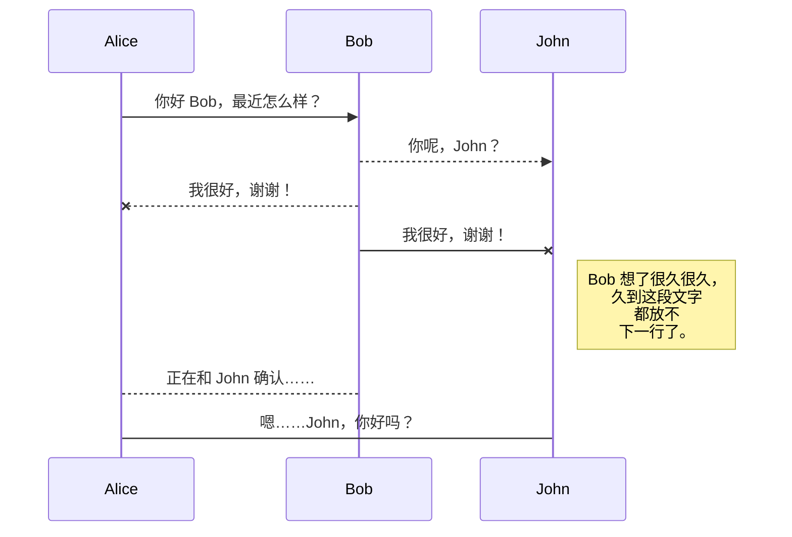
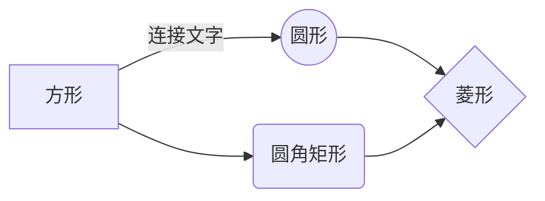
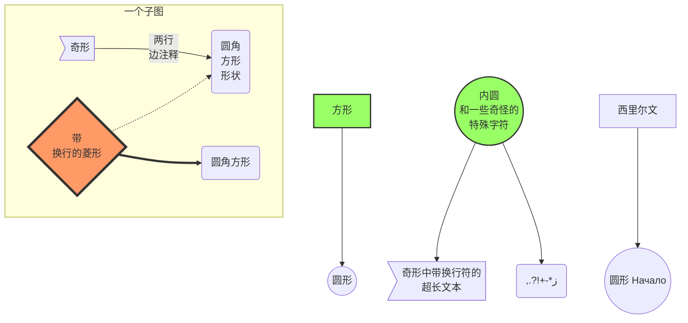
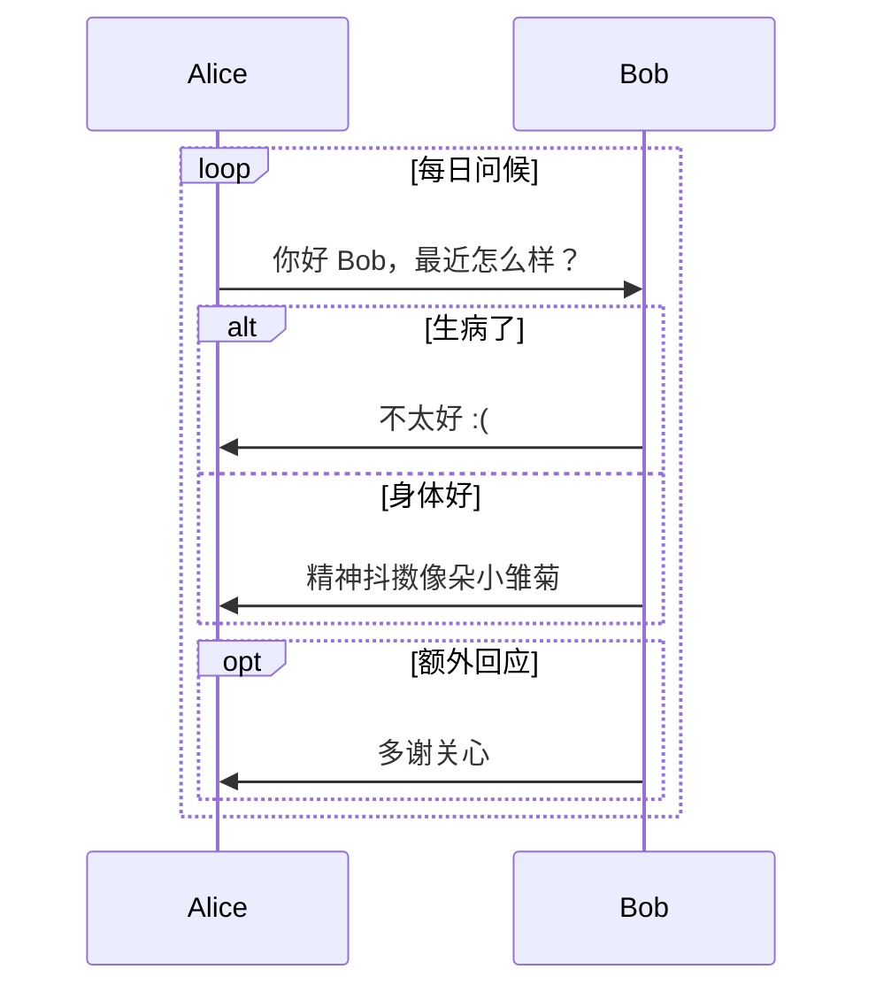

本页面已禁用评论，请滚动到页面底部查看。

# 注意！

不要在 YAML front matter 中使用 `[]`。

行内公式中请用 `\newline` 代替 `\\`。

`\substack` 是一个非常有用的命令。

`` 能被 typora 渲染，但 Jekyll 只渲染 ``

展示公式（display math）的上下必须留有空行，像这样。

```markdown
一些普通文本

$$
E=mc^2
$$

另一些文本
```



不要在公式中的任何位置使用 `{{`，请改用 `{ {`。Jekyll 会将其解析为 liquid 标签

行内公式中不要使用 `x_1`，请写成 `x _ 1`。Jekyll 会将其解析为斜体。



# 强调

*这是斜体。* **这是粗体**。 * 如果星号两侧被空格包围，则不会被解析。 *

_这也是斜体。_ __这也是粗体__。 _ 如果下划线两侧被空格包围，则不会被解析。 _

~~这是删除线~~。

markdown 中没有下划线语法。你可以使用 html 标签<u>像这样加下划线</u>。

`这是一个代码块`。

[这是一个外部链接](https://bit.ly)。`"https://"` 很重要。这是一个内部[链接](#这是-h2)。内部链接全部小写，空格用连字符 "-" 替换。

你可以混合使用，比如 [*这样*](https://bit.ly)、[`这样`](https://bit.ly)、**[这样](https://bit.ly)**，但不能像 `[这样](https://bit.ly)` 这样。

# 块级元素

> 这是一个引用块
>
> > 这是嵌套在另一个引用块中的引用块

```python
 import numpy as np
 print("""这是一个 Python 代码块""")
```

```fortran
 "这是一个 Fortran 代码块"
 implicit none
```

```
 这是一个简单代码块。你可以用它来显示文本，字体是等宽的。
```

你也可以混合使用，比如

> ```
>  这样
> ```

# 其他元素

这是一条水平分割线

------

# 数学公式

这是行内公式 $\sum_{i=1}^{N} i $。这是展示公式。
$$
\sum_{i=1}^{N} i 
$$
额外的空行很重要，否则你会得到
$$
\sum_{i=1}^{N} i
$$
[Mathjax](http://docs.mathjax.org/en/latest/tex.html) 的语法类似 latex。你不能使用 `\usepackge`，但可以像这样使用 `\newcommand`
$$
\newcommand{\NewOp}[2]{\lbrace{#1}\mid \otimes{#2}\rbrace}
$$
然后 `\NewOp` 在之后的所有公式块中都可用，无论是行内公式 $\NewOp{x}{y}$ 还是展示公式
$$
\NewOp{x}{y}
$$
在公式中使用竖线符号和下划线时要**非常小心**。如果你写成 $|x|\ge 0$、$|0|=0$，或者 $\lbrace x | x\gt 0\rbrace$ 这样，你会得到一堆乱码。

请改用 `\vert`，如 $\vert x\vert\ge 0$、$\vert 0\vert=0$；用 `\mid`，如 $\lbrace x \mid x\gt 0$。

同样，像这样使用下划线 $x_1$、$x_2$、$x_{c_2}^{c_3}$ 和 $y_{c_2}^{c_3}$，会被处理成_这样_。

给下划线两侧包上空格，像这样 $x _ 1$、$x _ 2$、$x _ {c _ 2}^{c _ 3}$ 和 $y _ {c _ 2}^{c _ 3 }$。

# 图片

Markdown 使用 `` 来引用图片，题注是可选的。你无法控制图片大小。


所以我更喜欢像这样使用 HTML 标签：


# 列表

- 这是无序列表
  - 子项
    - 子子项
      - 子子子项
        - 子子子子项 ……

------

- 列表可以有多行

  就像这样。

------

1. 这是有序列表
   1. 子项
2. 这个也是
3. 可以一直延续

------

1. 你可以像这样省略编号
   1. 子项
1. 它会自动延续
1. 等等等等


# mermaid 图表










# 表格

| 此列左对齐 | 此列居中对齐 | 此列右对齐 |
| :-------------------------- | :---------------------: | ---------------------------: |
| 1                           |            4            |                            7 |
| 2                           |            5            |                            8 |
| 3                           |            6            |                            9 |

| 表格中可以使用 ``。                    | 表格中可以使用数学公式。 | 表格中可以使用 ``。               |
| ------------------------------------------------------------ | --------------------------- | ------------------------------------------------------------ |
|  | $1+1=2$                     |  |

# 脚注

这是一个脚注[^1]。脚注可以带题注，比如[^this]。同一个脚注可以被多次引用，比如[^this]。脚注还有很多其他用法，比如[^this-one]。或者就像[^that]这样。这是一个指向某页面的[引用式链接][linkid]。[这个][linkid]也是一个链接。[这个][]和[那个]也是。

# 标题

# 这是 h1

## 这是 h2

### 这是 h3

#### 这是 h4

##### 这是 h5

###### 这是 h6

# 脚注

脚注就像这样

[^1]: https://EloitHao.github.io
[^this]: https://EloitHao.github.io
[^this-one]: 

```
> 脚注中可以使用引用块。
```

```
    也可以使用代码块
```

[^that]: 或者，自然而然地，简单的段落。

[linkid]: https://EloitHao.github.io	"可选标题"
